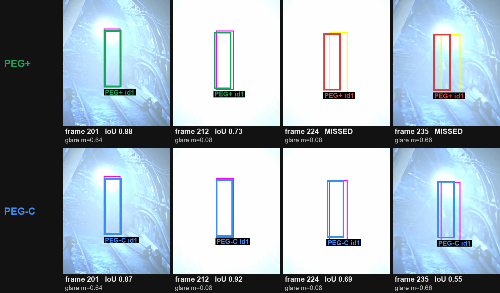
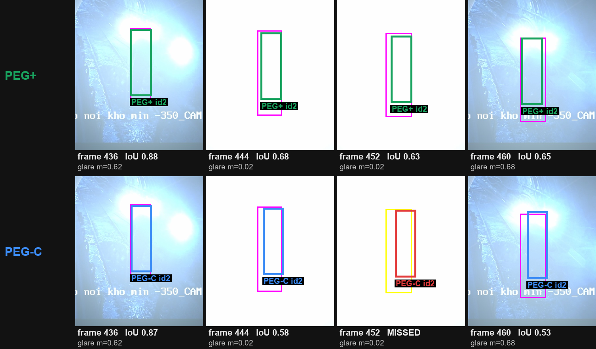
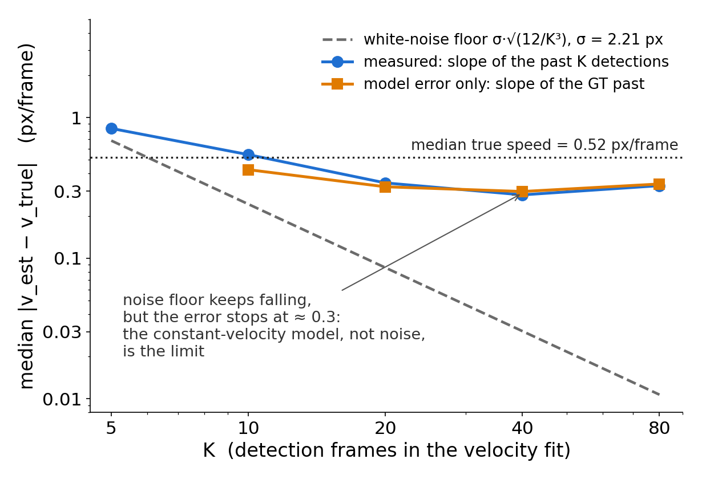

# PEG-C: thiết kế cách coast (kết quả)

Commit: `0f92215` (protocol pre-registered), `134d947` (code + addendum 1). Mọi số dưới đây sinh bởi `results/peg_c/collect.py` + `make_results_md.py` từ report/ledger (không gõ tay).

## Ý tưởng
PEG quyết định *có* giữ box hay không (cổng phi >= h). PEG-C thiết kế *giữ như thế nào*: một mô hình vận tốc không đổi (CV) duy nhất, dùng như bộ lọc online (V, C, S) và như bộ làm mượt fixed-lag (B, BB). Mỗi thành phần có một núm:

| | làm gì | lưới (val chọn) |
|---|---|---|
| P | PEG+ size lock (có sẵn theo thiết kế) | – |
| V | vận tốc nền dài lúc vào coast: OLS trên K tâm detection gần nhất, trục bị về 0 nếu \|v\| <= t·SE | K20 t0; K20 t2; K40 t0; K40 t2 |
| C | trần nhân quả: cổng chỉ được arm khi time_since_update <= N | cap 48; cap 90 |
| S | burn-exit stitch: detection sắp được *sinh* mà nằm sát box dự đoán của track vừa cháy thì nối lại (1:1) | stitch k 1.0; stitch k 1.5 |
| B | backfill fixed-lag: nội suy tuyến tính giữa hai detection ở hai đầu khoảng cháy (hidden = chỉ thêm hàng thiếu, all = thay luôn box coast) | L45 hidden; L45 all; L90 hidden; L90 all |
| BB | backward birth fixed-lag: track cháy ngay lúc sinh được thêm hàng ngược về trước | backward birth |

## Lưu ý đặt lên đầu
- Các thành phần được chọn từ phân tích oracle đã **gộp val và test** (`results/research/ORACLE_T3.md` Follow-up 3, `RESIDUAL_POOLS.md`) và từ các case lỗi trên test. Không tham số nào tune trên test; val chọn trong lưới đăng ký trước; test chạy một lần.
- **Rò rỉ synthetic**: `synth_glare.apply_glare` đặt đĩa chói theo đúng GT box, nên mọi phương pháp đọc hình/vị trí đĩa đều rò rỉ GT trên T2/T3. PEG-C chỉ đọc cổng tồn tại (phi >= h, như PEG) và detection của chính track; không bao giờ đọc hình học đĩa.
- **Hàng fixed-lag không phải online**: B và BB ghi lại/thêm hàng tới L khung trong quá khứ. Mọi hàng thuộc họ này luôn ghi nhãn "fixed-lag L" và báo riêng, không trộn với hàng online.
- Val nhỏ (17 seq thật, 18 episode T3): kết quả null trên val ít thông tin, nhưng vẫn là luật.

## Bảng test, guard tắt (setting của paper)

PEG-C online = P + V (K 40, t 2) — **do val chọn**. PEG-C fixed-lag 90 (B hidden, L 90) — *không được val chọn* (hàng fixed-lag, chỉ để tham khảo).

| | T1 HOTA | DetA | AssA | IDF1 | MOTA | IDSW | FP | FN |
|---|---|---|---|---|---|---|---|---|
| paper PEG | 68.20 | – | – | 82.30 | 80.62 | 17 | 1425 | 2611 |
| PEG | 68.19 | 65.88 | 71.62 | 82.30 | 80.62 | 17 | 1425 | 2611 |
| PEG+ | 68.23 | 65.96 | 71.62 | 82.24 | 80.52 | 17 | 1440 | 2618 |
| PEG-C online | 68.49 | 65.88 | 72.22 | 83.24 | 80.58 | 18 | 1461 | 2583 |
| PEG-C fixed-lag 90 (không chọn) | 68.48 | 65.87 | 72.22 | 83.23 | 80.57 | 16 | 1465 | 2582 |

| | T2 HOTA | AssA | MOTA | FP | Rcll | IDF1 | IDSW |
|---|---|---|---|---|---|---|---|
| paper PEG | – | – | 73.24 | 2024 | 85.61 | 75.29 | – |
| PEG | 61.70 | 63.17 | 73.26 | 2022 | 85.62 | 75.30 | 19 |
| PEG+ | 62.54 | 64.86 | 73.37 | 2113 | 86.26 | 77.95 | 16 |
| PEG-C online | 61.15 | 62.05 | 73.63 | 2058 | 86.22 | 75.30 | 20 |
| PEG-C fixed-lag 90 (không chọn) | 61.04 | 62.05 | 73.21 | 2128 | 86.22 | 75.14 | 20 |

| | T3 clear | Rcv@.5 | heavy | total | ID-off % | survived | IDSW | Frag |
|---|---|---|---|---|---|---|---|---|
| paper PEG | 93.0 | 76.5 | 74.1 | 77.6 | 18.5 | – | – | – |
| PEG | 93.0 | 76.6 | 74.1 | 77.8 | 18.5 | 19/30 | 4 | 13 |
| PEG+ | 93.3 | 82.2 | 78.9 | 85.1 | 15.5 | 21/30 | 3 | 12 |
| PEG-C online | 93.3 | 80.5 | 79.6 | 81.8 | 14.6 | 20/30 | 3 | 15 |
| PEG-C fixed-lag 90 (không chọn) | 93.3 | 80.5 | 79.6 | 81.8 | 14.6 | 20/30 | 3 | 15 |

Val T3 Rcv@.5 (guard tắt): PEG 67.6, PEG+ 67.3, PEG-C online 75.8, PEG-C fixed-lag 90 75.8. Fixed-lag hidden giống hệt online trên T3 (cả test lẫn val): B hidden không thêm hàng nào ở T3.

Chênh PEG-C online so với PEG+ / PEG (test, guard tắt):

- T1 IDF1 +1.00 so với PEG+, +0.94 so với PEG; T1 HOTA +0.26 / +0.30.
- T2 HOTA -1.39 so với PEG+ (AssA -2.81, IDSW 16 → 20); -0.55 so với PEG.
- T3 Rcv@.5 -1.7 so với PEG+ (82.2 → 80.5); +3.9 so với PEG; total -3.3 so với PEG+.

## Chọn trên val (Thach harness, guard bật, pre-registered)

### Online, luật chặt (single-event check): {P, V, C, S}

Bắt đầu S0+P: val T1 70.11 / T2 76.3 / T3 67.3.

Vòng 1:

| thêm | Δ T1 | Δ T2 | Δ T3 | score | admissible |
|---|---|---|---|---|---|
| V[0] (K20 t0) | +0.00 | -0.38 | +4.0 | +3.62 | có |
| V[1] (K20 t2) | +0.00 | -0.39 | +3.8 | +3.41 | có |
| V[2] (K40 t0) | -0.45 | -0.10 | +8.5 | +7.95 | có |
| V[3] (K40 t2) | -0.44 | -0.10 | +8.5 | +7.96 | có |
| C[0] (cap 48) | +0.07 | +0.00 | +0.0 | +0.07 | có (score <= 0.5: không chọn) |
| C[1] (cap 90) | +0.04 | +0.00 | +0.0 | +0.04 | có (score <= 0.5: không chọn) |
| S[0] (stitch k 1.0) | +0.00 | +0.66 | +0.0 | +0.66 | có |
| S[1] (stitch k 1.5) | +0.00 | +0.66 | +0.0 | +0.66 | có |

Kiểm tra single-event V[3]: score +7.96, bỏ đơn vị có lợi nhất còn +5.36 → qua.

→ chấp nhận: V[3] (K40 t2)

Vòng 2:

| thêm | Δ T1 | Δ T2 | Δ T3 | score | admissible |
|---|---|---|---|---|---|
| C[0] (cap 48) | +0.09 | +0.00 | +0.0 | +0.09 | có (score <= 0.5: không chọn) |
| C[1] (cap 90) | +0.04 | +0.00 | +0.0 | +0.04 | có (score <= 0.5: không chọn) |
| S[0] (stitch k 1.0) | +0.00 | +1.30 | +0.0 | +1.30 | có |
| S[1] (stitch k 1.5) | +0.00 | +1.30 | +0.0 | +1.30 | có |

Kiểm tra single-event S[0]: score +1.30, bỏ đơn vị có lợi nhất còn -0.07 → trượt.

Kiểm tra single-event S[1]: score +1.30, bỏ đơn vị có lợi nhất còn -0.07 → trượt.

→ chấp nhận: không có

**FINAL = `P[0] + V[3]`** (val T1 69.67 / T2 76.2 / T3 75.8), key `tv8267a438`.

### Online, luật mạnh nhất (không single-event check)

Bắt đầu S0+P: val T1 70.11 / T2 76.3 / T3 67.3.

Vòng 1:

| thêm | Δ T1 | Δ T2 | Δ T3 | score | admissible |
|---|---|---|---|---|---|
| V[0] (K20 t0) | +0.00 | -0.38 | +4.0 | +3.62 | có |
| V[1] (K20 t2) | +0.00 | -0.39 | +3.8 | +3.41 | có |
| V[2] (K40 t0) | -0.45 | -0.10 | +8.5 | +7.95 | có |
| V[3] (K40 t2) | -0.44 | -0.10 | +8.5 | +7.96 | có |
| C[0] (cap 48) | +0.07 | +0.00 | +0.0 | +0.07 | có (score <= 0.5: không chọn) |
| C[1] (cap 90) | +0.04 | +0.00 | +0.0 | +0.04 | có (score <= 0.5: không chọn) |
| S[0] (stitch k 1.0) | +0.00 | +0.66 | +0.0 | +0.66 | có |
| S[1] (stitch k 1.5) | +0.00 | +0.66 | +0.0 | +0.66 | có |

→ chấp nhận: V[3] (K40 t2)

Vòng 2:

| thêm | Δ T1 | Δ T2 | Δ T3 | score | admissible |
|---|---|---|---|---|---|
| C[0] (cap 48) | +0.09 | +0.00 | +0.0 | +0.09 | có (score <= 0.5: không chọn) |
| C[1] (cap 90) | +0.04 | +0.00 | +0.0 | +0.04 | có (score <= 0.5: không chọn) |
| S[0] (stitch k 1.0) | +0.00 | +1.30 | +0.0 | +1.30 | có |
| S[1] (stitch k 1.5) | +0.00 | +1.30 | +0.0 | +1.30 | có |

→ chấp nhận: S[0] (stitch k 1.0)

Vòng 3:

| thêm | Δ T1 | Δ T2 | Δ T3 | score | admissible |
|---|---|---|---|---|---|
| C[0] (cap 48) | +0.09 | +0.00 | +0.0 | +0.09 | có (score <= 0.5: không chọn) |
| C[1] (cap 90) | +0.04 | +0.00 | +0.0 | +0.04 | có (score <= 0.5: không chọn) |

→ chấp nhận: không có

**FINAL = `P[0] + S[0] + V[3]`** (val T1 69.67 / T2 77.5 / T3 75.8), key `tv869c07b7`.

### Fixed-lag: thêm B, BB lên trên tune_C

Bắt đầu S0+P: val T1 69.67 / T2 76.2 / T3 75.8.

Vòng 1:

| thêm | Δ T1 | Δ T2 | Δ T3 | score | admissible |
|---|---|---|---|---|---|
| B[0] (L45 hidden) | +0.00 | +0.00 | +0.0 | +0.00 | có (score <= 0.5: không chọn) |
| B[1] (L45 all) | -0.01 | +0.28 | -2.1 | -1.83 | không |
| B[2] (L90 hidden) | +0.03 | +0.00 | +0.0 | +0.03 | có (score <= 0.5: không chọn) |
| B[3] (L90 all) | +0.02 | +0.28 | -2.1 | -1.80 | không |
| BB[0] (backward birth) | +0.00 | +0.00 | +0.0 | +0.00 | có (score <= 0.5: không chọn) |

→ chấp nhận: không có

**FINAL = `P[0] + V[3]`** (val T1 69.67 / T2 76.2 / T3 75.8), key `tv8267a438`.

### ALL: PEG-C + các thành phần của Thach (luật mạnh nhất)

Bắt đầu S0+P: val T1 69.67 / T2 76.2 / T3 75.8.

Vòng 1:

| thêm | Δ T1 | Δ T2 | Δ T3 | score | admissible |
|---|---|---|---|---|---|
| R[0] | -0.18 | +0.00 | +0.0 | -0.18 | có (score <= 0.5: không chọn) |
| M1q[0] | +0.00 | +0.00 | +0.0 | +0.00 | có (score <= 0.5: không chọn) |
| M1q[1] | +0.00 | +0.00 | +0.0 | +0.00 | có (score <= 0.5: không chọn) |
| M1q[2] | +0.00 | +0.00 | +0.0 | +0.00 | có (score <= 0.5: không chọn) |
| M1c[0] | +0.42 | +1.29 | +0.0 | +1.71 | có |
| M1c[1] | +0.42 | +1.29 | +0.0 | +1.71 | có |
| M1c[2] | +0.40 | +1.29 | +0.0 | +1.69 | có |
| M1c[3] | +0.40 | +1.29 | +0.0 | +1.69 | có |
| M1d[0] | +0.00 | -0.53 | +0.2 | -0.33 | không |
| M2[0] | +0.00 | +0.00 | +0.0 | +0.00 | có (score <= 0.5: không chọn) |
| M2[1] | +0.00 | +0.00 | +0.0 | +0.00 | có (score <= 0.5: không chọn) |
| M2[2] | +0.00 | +0.00 | +0.0 | +0.00 | có (score <= 0.5: không chọn) |
| M3[0] | +0.06 | +0.00 | +0.0 | +0.06 | có (score <= 0.5: không chọn) |
| M3[1] | +0.06 | +0.00 | +0.0 | +0.06 | có (score <= 0.5: không chọn) |
| M3[2] | +0.06 | +0.00 | +0.0 | +0.06 | có (score <= 0.5: không chọn) |
| M3[3] | +0.06 | +0.00 | +0.0 | +0.06 | có (score <= 0.5: không chọn) |
| M3[4] | +0.06 | +0.00 | +0.0 | +0.06 | có (score <= 0.5: không chọn) |
| M3[5] | +0.06 | +0.00 | +0.0 | +0.06 | có (score <= 0.5: không chọn) |
| M3[6] | +0.00 | +0.00 | +0.0 | +0.00 | có (score <= 0.5: không chọn) |
| M4[0] | +0.00 | +0.00 | +0.0 | +0.00 | có (score <= 0.5: không chọn) |
| M4[1] | +0.00 | +0.00 | +0.0 | +0.00 | có (score <= 0.5: không chọn) |
| M4[2] | +0.00 | +0.00 | +0.0 | +0.00 | có (score <= 0.5: không chọn) |
| M5[0] | -0.02 | -0.29 | -3.1 | -3.41 | không |
| M5[1] | -0.02 | -0.16 | -1.7 | -1.88 | không |
| M5[2] | +0.00 | -0.07 | -0.8 | -0.87 | không |
| M6[0] | -0.10 | -0.12 | +0.2 | -0.02 | có (score <= 0.5: không chọn) |

→ chấp nhận: M1c[0]

Vòng 2 (4 dòng điểm cao nhất trong 22):

| thêm | Δ T1 | Δ T2 | Δ T3 | score | admissible |
|---|---|---|---|---|---|
| M3[0] | +0.09 | +0.00 | +0.0 | +0.09 | có (score <= 0.5: không chọn) |
| M3[1] | +0.09 | +0.00 | +0.0 | +0.09 | có (score <= 0.5: không chọn) |
| M3[3] | +0.09 | +0.00 | +0.0 | +0.09 | có (score <= 0.5: không chọn) |
| M3[2] | +0.08 | +0.00 | +0.0 | +0.08 | có (score <= 0.5: không chọn) |

→ chấp nhận: không có

**FINAL = `M1c[0] + P[0] + V[3]`** (val T1 70.09 / T2 77.49 / T3 75.8), key `tvbbd5a238`.

`tune_C_lag_all`: = tune_C_all (lag stage accepted nothing).

### Vì sao các thành phần bị loại

- **V**: được chọn, V[3] (K 40, t 2): val T3 Rcv +8.5, T1 -0.44, T2 -0.10; qua single-event check (+5.36).
- **S (stitch)**: gain val T2 = +1.25 nhưng từ một sequence (147 +11.4 HOTA); bỏ nó còn -0.29; check single-event -0.07 → trượt ở luật chặt. Luật mạnh nhất vẫn nhận S[0].
- **C (trần nhân quả)**: score lớn nhất +0.07 (<= 0.5): không đáng kể.
- **B hidden**: score +0.00 / +0.03 (L 45 / L 90): không thêm hàng nào ở T3 (hàng test và val giống hệt online) vì cổng đã phát box cho gần như mọi khung của khoảng trống.
- **B all** làm tệ T3 val -2.1: 141 g71 22→24 (n 24); 178 g206 4→0 (n 43); 332 g1030 10→0 (n 29) (nội suy thay luôn box coast).
- **BB**: không kích hoạt ở lần chạy val nào (score +0.00).

## Thach harness (guard bật), val + test

| config | split | T1 HOTA | T1 IDF1 | T1 MOTA | T1 IDSW | T2 HOTA | T2 IDF1 | T2 MOTA | T3 Rcv@.5 | T3 total | T3 ID-off |
|---|---|---|---|---|---|---|---|---|---|---|---|
| PEG | val | 70.24 | 86.35 | 82.06 | 15 | 76.25 | 89.19 | 89.73 | 67.6 | 67.4 | 10.0 |
| PEG | test | 68.34 | 82.68 | 80.59 | 15 | 61.41 | 74.61 | 73.48 | 76.2 | 77.1 | 18.5 |
| PEG+ | val | 70.11 | 86.06 | 82.20 | 17 | 76.30 | 89.24 | 89.80 | 67.3 | 66.3 | 10.0 |
| PEG+ | test | 68.41 | 82.68 | 80.77 | 15 | 62.33 | 77.52 | 73.99 | 82.2 | 85.1 | 15.5 |
| PEG-C online | val | 69.67 | 84.96 | 82.78 | 16 | 76.20 | 88.63 | 91.27 | 75.8 | 74.1 | 10.0 |
| PEG-C online | test | 68.80 | 84.26 | 80.98 | 15 | 60.89 | 74.61 | 74.55 | 80.4 | 81.8 | 18.5 |
| PEG-C fixed-lag 90 (B hidden; val only) | val | 69.70 | 85.00 | 82.85 | 16 | 76.20 | 88.63 | 91.27 | 75.8 | 74.1 | 10.0 |
| PEG-C fixed-lag 90 (B hidden; val only) | test | – | – | – | – | – | – | – | – | – | – |
| PEG-C strongest | val | 69.67 | 84.96 | 82.78 | 16 | 77.50 | 90.24 | 91.36 | 75.8 | 74.1 | 10.0 |
| PEG-C strongest | test | 68.86 | 84.34 | 81.16 | 14 | 62.67 | 78.29 | 75.55 | 81.2 | 81.8 | 10.5 |
| ALL = PEG-C + Thach greedy | val | 70.09 | 85.55 | 82.75 | 17 | 77.49 | 90.25 | 91.38 | 75.8 | 74.1 | 10.0 |
| ALL = PEG-C + Thach greedy | test | 68.78 | 84.24 | 80.95 | 15 | 61.35 | 75.45 | 75.13 | 81.2 | 81.8 | 11.6 |
| Thach best (STRONGEST with PEG+ by design) | val | 70.54 | 86.64 | 82.16 | 18 | 77.63 | 91.24 | 89.84 | 67.3 | 66.3 | 10.0 |
| Thach best (STRONGEST with PEG+ by design) | test | 68.44 | 82.71 | 80.88 | 15 | 63.14 | 78.50 | 75.05 | 83.1 | 85.1 | 11.6 |
| Thach full+M6 (his params, tuned on test) | val | 69.85 | 85.37 | 81.75 | 48 | 73.16 | 85.30 | 86.62 | 37.1 | 32.6 | 21.9 |
| Thach full+M6 (his params, tuned on test) | test | 70.03 | 87.03 | 80.43 | 29 | 61.21 | 77.56 | 69.48 | 53.6 | 55.4 | 10.5 |

Test chạy đúng một lần cho `tune_C`, `tune_C_strong`, `tune_C_all` (`tune_C_lag` có final trùng `tune_C` → không chạy lại; `tune_C_lag_all` bị bỏ).

## Theo episode (T3)

- test: 30 ep. — Rcv PEG 76.6 / PEG+ 82.2 / PEG-C 80.5 / PEG-C lag 80.5; PEG-C so với PEG+ Δ -1.8 CI95 [-7.7, +3.6], tốt hơn 4 / tệ hơn 5 / bằng 21 (+21 / −36 frame); so với PEG Δ +3.9 CI95 [-3.9, +12.2] (6/6).
- val: 18 ep. — Rcv PEG 67.6 / PEG+ 67.3 / PEG-C 75.8 / PEG-C lag 75.8; PEG-C so với PEG+ Δ +8.6 CI95 [+3.0, +15.7], tốt hơn 9 / tệ hơn 1 / bằng 8 (+50 / −1 frame); so với PEG Δ +8.2 CI95 [+3.4, +13.9] (9/1).
- pooled: 48 ep. — Rcv PEG 73.0 / PEG+ 76.2 / PEG-C 78.6 / PEG-C lag 78.6; PEG-C so với PEG+ Δ +2.4 CI95 [-2.1, +6.8], tốt hơn 13 / tệ hơn 6 / bằng 29 (+71 / −37 frame); so với PEG Δ +5.6 CI95 [+0.5, +11.1] (15/7).

Episode khác PEG+ (test): seq g<id> frames: covered PEG / PEG+ / PEG-C / PEG-C lag (n) | sai số tâm px PEG+ / PEG-C

- 135_sequence_19q_new g53 409-451: 4 / 4 / 2 / 2 (43) | 70.5 / 88.6
- 145_sequence_28q_new g84 1094-1130: 28 / 31 / 36 / 36 (37) | 6.7 / 6.4
- 176_sequence_56q_new g204 331-355: 22 / 25 / 10 / 10 (25) | 11.9 / 14.7
- 183_sequence_62q_new g241 708-731: 24 / 24 / 21 / 21 (24) | 12.7 / 13.8
- 204_sequence_81q_complete g300 102-141: 40 / 38 / 40 / 40 (40) | 2.6 / 3.0
- 204_sequence_81q_complete g300 342-383: 25 / 25 / 21 / 21 (42) | 13.6 / 16.0
- 211_sequence_88q_new g320 436-460: 25 / 25 / 13 / 13 (25) | 20.3 / 27.4
- 316_sequence_112q_new g6 2000-2034: 22 / 22 / 35 / 35 (35) | 31.6 / 17.5
- 325_sequence_92q_new g3 267-299: 10 / 30 / 31 / 31 (33) | 59.0 / 35.7

Episode khác PEG+ (val): seq g<id> frames: covered PEG / PEG+ / PEG-C / PEG-C lag (n) | sai số tâm px PEG+ / PEG-C

- 133_sequence_17q_new g117 3239-3275: 17 / 17 / 24 / 24 (37) | 20.3 / 13.3
- 141_sequence_24q_new g71 161-184: 12 / 12 / 22 / 22 (24) | 12.8 / 8.6
- 147_sequence_3q_new g79 497-541: 38 / 38 / 40 / 40 (45) | 7.6 / 6.9
- 178_sequence_58q_new g205 93-128: 30 / 30 / 36 / 36 (36) | 39.8 / 17.4
- 178_sequence_58q_new g206 567-609: 2 / 2 / 4 / 4 (43) | 24.4 / 11.7
- 187_sequence_66q_new g247 201-235: 25 / 19 / 35 / 35 (35) | 9.1 / 4.7
- 203_sequence_80q_new g299 104-146: 42 / 42 / 43 / 43 (43) | 5.9 / 3.4
- 203_sequence_80q_new g299 306-340: 35 / 33 / 35 / 35 (35) | 11.1 / 12.7
- 210_sequence_87q_complete g317 192-209: 16 / 16 / 15 / 15 (18) | 5.8 / 6.6
- 332_sequence_99q_complete g1030 209-237: 3 / 6 / 10 / 10 (29) | 36.3 / 33.3

## Oracle: coast có thể thiết kế được không?

Ước lượng vận tốc từ quá khứ detection của PEG+, áp như vận tốc không đổi từ anchor (43 episode có track; `results/research/ORACLE_T3.md` Follow-up 3). bK = OLS trên K detection gần nhất; gK = cùng OLS trên GT (chỉ lỗi mô hình).

| policy | test | val | pooled | med \|v_est − v_true\| px/f (pooled) |
|---|---|---|---|---|
| (a) frozen | 71.4 | 75.3 | 72.9 | – |
| b5 | 65.2 | 59.2 | 62.9 [51.9, 74.0] | 0.837 |
| b10 | 81.0 | 74.6 | 78.6 [68.2, 88.4] | 0.545 |
| b20 | 87.9 | 81.6 | 85.5 [76.0, 93.7] | 0.343 |
| b40 | 88.5 | 86.6 | 87.8 [78.7, 95.3] | 0.282 |
| b80 | 78.6 | 82.1 | 79.9 [70.5, 88.8] | 0.328 |
| g40 | 88.8 | 94.6 | 91.0 [83.5, 96.8] | 0.298 |
| (i) oracle const-velocity (GT) | 98.2 | 92.4 | 96.0 | – |
| (d) oracle centre | 99.9 | 100.0 | 99.9 | – |
| PEG+ actual (same episodes) | 88.0 | 77.9 | 84.2 | – |

Kiểm tra cài đặt (`scripts/21_peg_c_check.py`, hàm `ols_velocity` của tracker): b40 = 88.5 / 86.6 / 87.8, b20 = 87.9 / 81.6 / 85.5 (test / val / pooled), khớp 87.8 / 85.5 đã công bố; 0 episode lệch.

### Nhiễu hay mô hình? (slope_noise)

σ = 2.21 px (median trên 43 episode của sqrt(σx² + σy²), σ_x median 1.53, σ_y median 1.36; phần dư OLS trên 40 detection cuối của PEG+). Sàn nhiễu trắng σ·√(12/K³): K = 5/10/20/40/80 → 0.685 / 0.242 / 0.086 / 0.030 / 0.011 px/frame.
Sai số đo được: b5 0.837 / b10 0.545 / b20 0.343 / b40 0.282 / b80 0.328; chỉ-mô-hình (GT): g10 0.426 / g20 0.322 / g40 0.298 / g80 0.337.
Kết luận: sàn nhiễu tiếp tục giảm nhưng sai số dừng ở ≈ 0.28–0.33 px/frame (b40–b80) ≈ 54–63% tốc độ thật median 0.52 px/frame: giới hạn là mô hình CV (người đổi nhịp), không phải nhiễu. K = 5 là nhiễu (0.837 px/frame > 0.521).

## Phân tích sau test (post-test analysis, KHÔNG dùng để chọn)

Replay có thiết bị đo (`diag_test_losses.py`): cấu hình pegc, guard tắt, cache; hàng MOT replay **trùng từng byte** với `pegc_rcv` / `v_pegc_rcv`.

| episode | covered PEG+ → PEG-C | oracle b40 | v OLS (t=0) | Kalman v lúc vào coast (PEG+ giữ nguyên) | v thật (GT) | số lần vào coast (từ 60 khung trước burn tới hết burn) |
|---|---|---|---|---|---|---|
| 176 g204 331-355 (test) | 25 → 10 | 21 | (-1.02, -0.87) | (-1.29, -0.77) | (-1.24, -0.47) | 1 (khung 331) |
| 211 g320 436-460 (test) | 25 → 13 | 20 | (+0.53, +1.08) | (-0.33, +1.42) | (-0.08, +1.96) | 1 (khung 435) |
| 187 g247 201-235 (val) | 19 → 35 | 35 | (+0.33, +0.29) | (-0.04, +0.33) | (+0.53, +0.46) | 2 (khung 141, 200) |

- Mỗi burn là một lần coast liên tục: không có re-acquisition (không vào coast lại) bên trong burn, nên vận tốc chỉ được ước lượng một lần lúc vào coast.
- Trên các episode này khác biệt duy nhất giữa PEG+ và PEG-C là **vận tốc lúc vào coast** (cùng damping ×0.95 sau gap 10, cùng EMA, cùng size lock). Speed guard và trần 2·median-step không bao giờ kích hoạt; t = 2 không triệt trục nào (trên các lần vào coast ở bảng).
- Trên 176 g204 và 211 g320 vận tốc Kalman sẵn có của PEG+ lúc vào coast gần vận tốc thật hơn OLS 40 khung: 176: Kalman (-1.29, -0.77) so với OLS (-1.02, -0.87), thật (-1.24, -0.47); 211: Kalman (-0.33, +1.42) so với OLS (+0.53, +1.08), thật (-0.08, +1.96). (Với 211 số Kalman lấy từ chính lần chạy pegc nên có thể lệch nhẹ so với lần chạy PEG+ vì V đã áp ở lần coast trước.)
- Nền dài lỗi thời khi người đổi nhịp hoặc khi cửa sổ 40 detection bắc qua một khoảng trống trước đó: ở 211 cửa sổ gồm khung 355–374 và 415–434, giữa chúng là gap 40 khung trong đó người đã di chuyển; `_det_hist` không bị xóa theo đúng spec nên OLS trộn hai đoạn.
- Trên val nền dài thắng (9 tốt hơn / 1 tệ hơn), ví dụ 187 g247 201-235: 19 → 35 khung; ở lần vào coast khung 200 OLS (+0.33, +0.29) gần vận tốc thật (+0.53, +0.46) hơn Kalman (-0.04, +0.33): cửa sổ sạch, người đi đều.
- Hai yếu tố làm oracle b40 tốt hơn tracker nhưng *không* giải thích PEG-C thua PEG+ (PEG+ chịu cả hai): oracle dùng box detection gốc cố định (44.7x160 ở 176) còn tracker coast box Kalman/EMA (47x157), và VEL_DAMP làm quãng dịch thực chỉ còn khoảng 83% — phép tính số học (không chạy tracker) trên 176: đi thẳng đều 17/25 khung, có damp 14/25, tracker thực 10/25.
- Trên 211 GT box lớn dần (60x215 → 80x260, người tiến lại gần camera) trong khi box size-lock giữ 65x208 nên IoU vượt dưới 0.5 giữa chừng bất kể vận tốc.

## Kết luận

- Val chấp nhận V; test **không xác nhận** trên T3: PEG-C so với PEG+ -1.8 (CI95 [-7.7, +3.6], 4 tốt hơn / 5 tệ hơn); val +8.6 [+3.0, +15.7] (9/1); pooled +2.4 [-2.1, +6.8].
- Lợi ích duy nhất trên test (cả hai harness; nhưng val T1 IDF1 lại −1.1 nên chưa chắc): T1 IDF1 +1.0 (guard tắt, vs PEG+) / +1.6 (guard bật, vs PEG).
- Chi phí: T2 HOTA -1.4 vs PEG+ (AssA -2.8, IDSW 16 → 20).
- S (strongest) giúp test T2 HOTA (62.67 so với 60.89 của PEG-C online) nhưng dựa vào một sequence (135 +20.1).
- Bài học: lợi ích oracle do val dẫn dắt vẫn do val dẫn dắt; sai số vận tốc dừng ở sàn của mô hình CV, không phải nhiễu.

## Lệnh

- implementation_checks: `.venv/Scripts/python.exe scripts/21_peg_c_check.py > results/peg_c/check21.txt ; bash results/peg_c/run_byteident.sh ; .venv/Scripts/python.exe results/peg_c/smoke_val.py ; .venv/Scripts/python.exe results/peg_c/wire_check.py ; .venv/Scripts/python.exe results/peg_c/port_check.py 1|2`
- val search (Thach harness, guard on): `.venv/Scripts/python.exe results/thach_v2/tune_val.py --peg_c ; --peg_c --strong ; --peg_c --lag ; --peg_c --all ; (--peg_c --lag --all skipped: lag accepted nothing); then --test for tune_C, tune_C_strong, tune_C_all`
- paper-setting rows (ours, guard off, cached): `bash results/peg_c/run_paper_rows.sh   # GMOT_TRACKER=beacon GMOT_BIRTH_SIZE_GUARD=0 GPEG_SIZE_LOCK=1 GPEG_VEL_K=40 GPEG_VEL_T=2 [+ GPEG_BACKFILL_L=90 GPEG_BACKFILL_MODE=hidden for pegcl_*]`
- episodes: `.venv/Scripts/python.exe results/peg_c/episodes.py`
- post-test diagnosis: `.venv/Scripts/python.exe results/peg_c/diag_test_losses.py`
- figures: `.venv/Scripts/python.exe results/peg_c/collect.py && .venv/Scripts/python.exe scripts/22_peg_c_figures.py`

Env của hàng paper-setting: `paper-setting rows: GMOT_TRACKER=beacon GMOT_BIRTH_SIZE_GUARD=0 GPEG_SIZE_LOCK=1 GPEG_VEL_K=40 GPEG_VEL_T=2; Thach harness rows use guard ON (his setting)`
